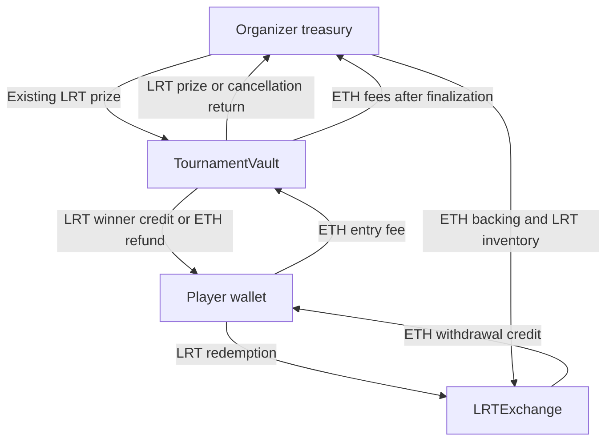
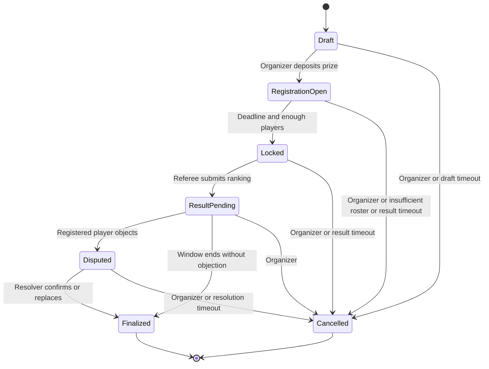

# System Design

## Contracts and trust

LearningRewardToken mints its entire supply once to the treasury. TournamentVault and LRTExchange reference that immutable deployed token. Neither contract mints or burns tokens. Exchange inventory may be funded with an ordinary token transfer. Buying tokens consumes that inventory and adds ETH reserve. Redemption returns tokens to inventory and reserves ETH for the seller.

## State machine

No registration or rule change is possible after the deadline. The only result replacement path belongs to the resolver in Disputed. Finalization is permissionless after the objection window; a pending result does not become cancellable merely because the referee's submission deadline later passes. The state selects the relevant deadline.

## Boundary rules

| Action | Allowed time |
| --- | --- |
| Fund and register | Strictly before registrationDeadline |
| Lock roster | At or after registrationDeadline |
| Referee submit | Strictly before resultDeadline |
| Raise objection | Strictly before disputeDeadline |
| Finalize unchallenged result | At or after disputeDeadline |
| Resolve objection | Strictly before resolutionDeadline |
| Recover abandoned draft | At or after registrationDeadline |
| Recover missing result | At or after resultDeadline, while Open or Locked |
| Recover unresolved objection | At or after resolutionDeadline |

Both review windows range from 60 seconds to seven days. Deadlines are block timestamps; production tournaments should allow practical margins rather than rely on second-level timing.

## Accounting

The vault tracks two independent liabilities. `ethLiability` rises on registration and falls only when ETH actually leaves through a successful withdrawal. Settlement moves accounting ownership from escrow to organizer credit without changing total liability. Cancellation credits players lazily through individual claims; no participant-wide loop is required.

`tokenLiability` rises when the full LRT prize is deposited. Settlement creates winner credits without changing that liability. Prize withdrawal or organizer cancellation return reduces liability before the token transfer. Reverting transfers revert all accounting changes.

The invariants are vault ETH balance >= ethLiability, vault token balance >= tokenLiability, and exchange ETH balance >= totalCredits. Equality is expected in controlled examples, but direct token donations or forced ETH may create surplus. No administrator sweep function exists.

Payout shares sum to 10000 basis points. Every rank except the last receives floor(prize × share / 10000); the last receives the exact remainder. Ranks are bounded at 32 and participants at 256. Winner validation uses at most 496 duplicate comparisons; settlement loops at most 32 times, without ETH receiver calls.

## Interface groups

| Contract | Public operations |
| --- | --- |
| Token | Standard ERC20 transfer, approval and balance queries |
| Vault setup | createTournament, getTournament, fundAndOpen |
| Participation | register, lockRegistration |
| Results | submitResult, raiseDispute, resolveDispute, finalizeResult |
| Recovery | cancelTournament, cancelExpired, claimRefund, refundOrganizer |
| Withdrawal | withdrawPrize, withdrawETH |
| Exchange | quote, availableReserve, buy, redeem, withdrawETH, receive ETH backing |

Match footage, evidence files, brackets and identities remain off-chain. Only hashes and wallet addresses are published. Distinct role addresses do not prove independent human control.
